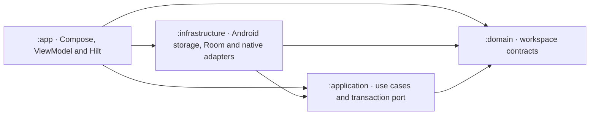

# ADR 0002 · Android layer boundaries

**Status** Accepted, 2026-11-24  
**Ticket** OW-001 / [KAN-27](https://omninumeris.atlassian.net/browse/KAN-27)  
**Traceability** NFR-08, with baseline coverage for FR-CUS-01 and NFR-06

## Decision

Arrows show allowed compile-time module dependencies. Keep the Hilt composition root in `:app` and the inner layers on Kotlin/JVM. `:verifyModuleDependencies` checks the module graph and rejects Android or native libraries on the inner layers' JVM classpaths.

The launch screen exercises the path from Compose through a Hilt ViewModel and application use case to the storage adapter. The adapter checks the app-private directory on the IO dispatcher without writing workspace content. The ViewModel publishes lifecycle-collected StateFlow state and allows retry after storage becomes unavailable.

The application transaction port and Room implementation define the metadata transaction boundary. The forthcoming OW-006 storage design owns database entities, migrations, encryption, and coordination with blob writes and recovery. Room transactions cover database operations. File operations require their own recovery protocol.

Keep API 29 as the minimum and ARM64 as the native release ABI. Debug also supports x86-64 for emulator testing. Future JNI adapters live under infrastructure and expose platform-independent contracts inward.

## References

- [OmniNumeris technical architecture](https://omninumeris.atlassian.net/wiki/spaces/OMNI/pages/688129)
- [Android dependency injection with Hilt](https://developer.android.com/training/dependency-injection/hilt-android)
