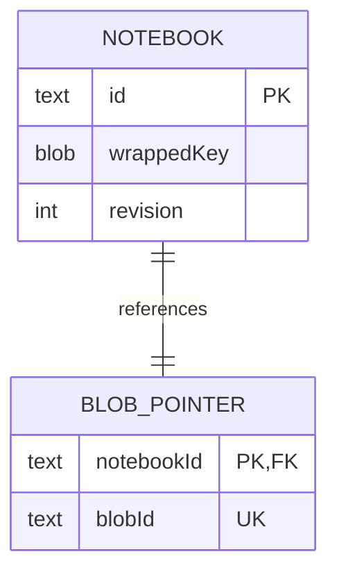
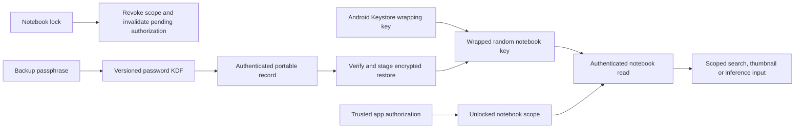

# ADR 0007 · Protected storage and portable recovery

**Status** Provisional for security review  
**Ticket** OW-006 / [KAN-32](https://omninumeris.atlassian.net/browse/KAN-32)  
**Traceability** FR-SEC-01, FR-RAG-01, NFR-05, NFR-06, NFR-08, NFR-09 and NFR-10

## Threat model

Device or file theft, archive tampering, interrupted writes, app-level lock bypass through secondary data, and malformed restore input are in scope. The prototype assumes the Android sandbox and a trusted local authorization service. A compromised OS or running app can read decrypted process memory. Flash storage secure erasure and resistance to replay of an entire valid older vault require separate controls.

## Metadata and persistence

Notebook and blob IDs are canonical UUIDs. The indexed current pointer is unique by blob ID, and its notebook foreign key cascades on delete. Room v2 adds a nonnegative revision starting at zero to the v1 schema while preserving IDs, key material and pointers. Future migrations must preserve references and pass upgrade fixtures. Put durable payloads in app-private storage excluded from system backup.

Write a fresh encrypted blob to a pending file, sync it, atomically rename it within the same directory, then sync that directory. The pending filename and the committed pointer act as the recovery journal for this single-blob protocol. Update the notebook revision and pointer in one Room transaction. Recovery validates that each committed pointer has a blob before collecting abandoned files. Single-process coordination serializes authorization, blob publishes, metadata commits and cleanup. SQLite uses full synchronization for the prototype. Missing referenced content stops recovery and preserves the remaining files. The production schema must extend this protocol for operations that span multiple assets.

## Key and access lifecycle

Use AES-256-GCM with fresh provider-generated nonces. Associated data binds the purpose and owning IDs and, for blobs, the revision. Keep the Keystore wrapping key local. A missing wrapping key during unwrap is a recovery error. Generate per-notebook random data keys, unwrap only for the permitted operation, and clear owned key bytes afterward. Production authorization must use the approved device/app authentication flow.

Protected search, thumbnail and inference reads share the same notebook authorization gate. The prototype searches only an unlocked notebook and keeps no decrypted index, preview cache or inference context. A future persistent index must be partitioned by authorized notebook, encrypted with its scope key, and excluded from global plaintext FTS. Production lock must also remove open previews and cancel and clear the inference context. Already delivered data and cryptographic provider buffers have separate lifetimes.

## Portable recovery

Use a versioned, bounded single-notebook binary record. The fixed header identifies the format and a random salt. PBKDF2-HMAC-SHA256 with 600,000 iterations derives the AES-256-GCM key for this provisional format. Authenticate the header as associated data and encrypt the manifest, notebook ID, revision and bounded snapshot together. The decoder verifies authenticity and manifest constraints before creating a new notebook. File paths come exclusively from validated UUIDs generated or decoded as fixed-width fields. A restore never replaces an existing notebook with the same identity. The format requires no plaintext staging files.

The prototype is debug-only and uses no production notebook data. Expand the snapshot format and verify authentication-bound Keystore policies, threat coverage, sustained storage stress and KDF latency before production selection.

The prototype now supports an opaque, process-local write lease for one continuous unlock session. The vault checks lease identity and expected revision under the same mutex as the encrypted write. Locking invalidates that notebook's lease. Reauthentication issues a fresh lease and cannot revive a pending mutation.

The debug adapter uses that lease to commit preview-approved verified typed math and calculator results inside the encrypted notebook snapshot. It binds previews to the unlock session, rechecks destination and read-only policy, and persists operation identity and undo state with the content. Undo keeps the original document and uses the active result projection to hide the reversed operation. The adapter accepts synthetic data during verification. The prototype snapshot, device authentication, lifecycle and cache clearing, protected source links, and production projections still require security review. The vault's raw debug search and inference helpers are unsuitable for production notebook projections.

The Keystore wrapper now supports an explicit device-credential policy for newly provisioned keys. On API 29 it uses a positive secure-lock-screen authentication window. On API 30 and later it explicitly requests device credential with the versioned authentication API. An existing alias must satisfy the requested policy. The probe uses a separate alias and does not retrofit existing notebook or history keys. The operating system's authentication window and the notebook's app-level lease are independent. A notebook lock must revoke app access immediately, including while the OS window remains valid. [Android Keystore API reference](https://developer.android.com/reference/android/security/keystore/KeyGenParameterSpec.Builder#setUserAuthenticationParameters(int,%20int))

The credential-bound debug vault uses a separate database directory and wrapping alias. Unlock must successfully unwrap the notebook key before it creates a lease. The app lease has a monotonic deadline and each successful credential unlock issues a new placement identity. An expired lease or preview remains invalid after later authentication. The debug harness can exercise this boundary through actual insertion and undo before the production lifecycle and projections are approved.

## Verification

On 2026-11-25, five instrumentation cases passed on the Samsung SM-X806B (API 36) and an API 29 emulator in airplane mode. They cover scoped access and stale authorization, authenticated blob reads and revision checks, wrong passwords and malformed or tampered backups, interrupted restore and simulated disk exhaustion, and migration from the schema v1 fixture while preserving the encrypted notebook. The emulator also survived a separate forced-process-death scenario. A fresh process kept the prior committed revision, cleared the orphan and started with the notebook locked.

The portable backup restored successfully to a fresh Android user on the offline emulator, with a separate app sandbox and Keystore namespace. The source fixture and its key had already been deleted. The restored notebook started locked, and authorization revealed the expected revision, document and thumbnail.

Gradle `:check :app:assembleDebug :app:assembleRelease` and the debug instrumentation APK build passed. A DEX inspection found the vault class in the debug APK and confirmed its absence from the release APK.

On 2026-11-26, the API 29 vault test run verified rejection while locked and after reauthentication, stale revision rejection, a fresh lease writing successfully, and scope-local lock invalidation. The run exercised six cases and skipped two separately provisioned cases for fresh-user restore and forced process death.

## References

- [OmniNumeris data and security design](../../03-Data-Security-UX.md)
- [OMNI security design](https://omninumeris.atlassian.net/wiki/spaces/OMNI/pages/589826)
- [OMNI schema and recovery design](https://omninumeris.atlassian.net/wiki/spaces/OMNI/pages/622636)
- [Android Keystore key authorization and randomized encryption](https://developer.android.com/reference/android/security/keystore/KeyGenParameterSpec.Builder)
- [OWASP PBKDF2 guidance](https://cheatsheetseries.owasp.org/cheatsheets/Password_Storage_Cheat_Sheet.html)
